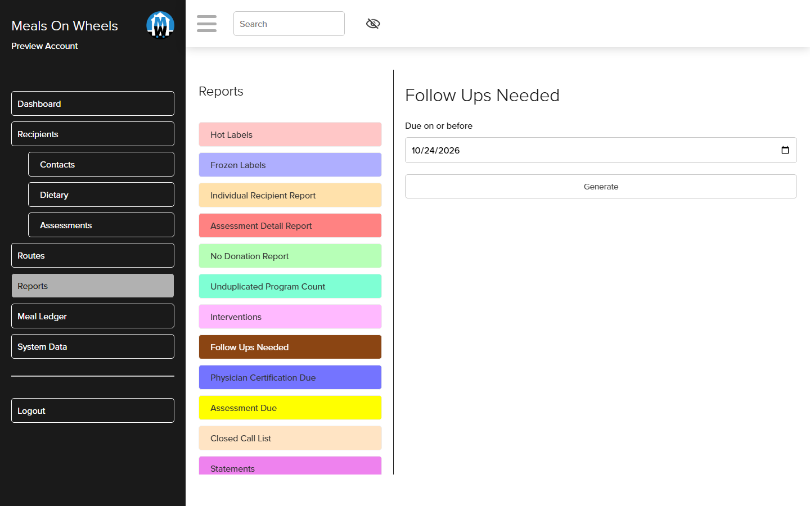
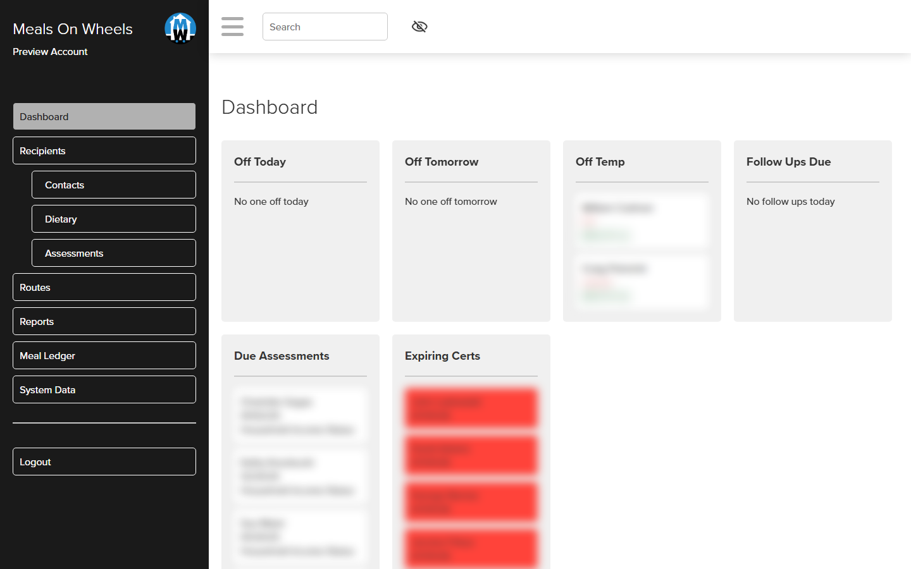
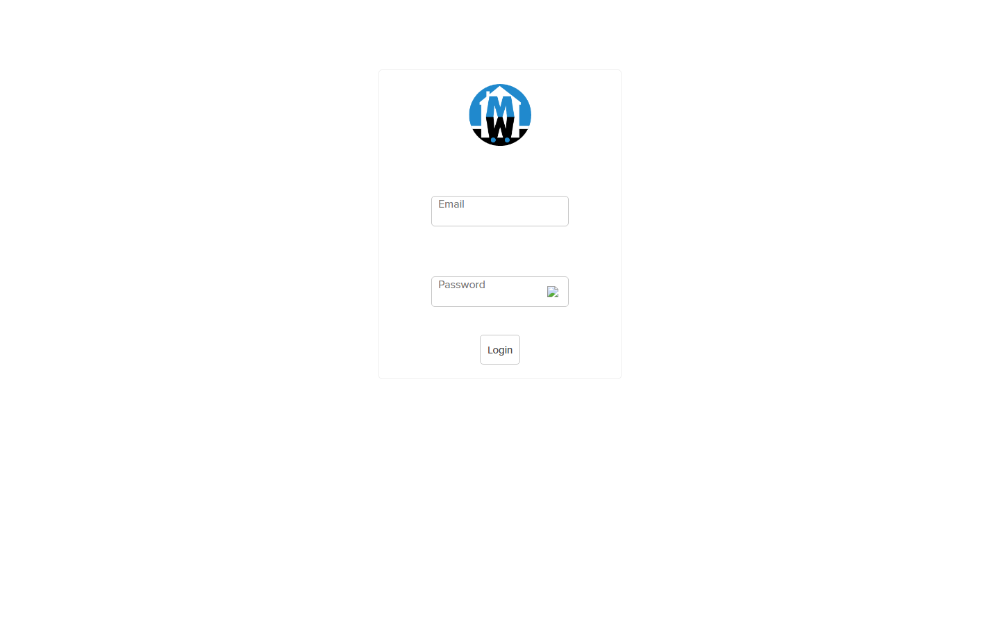
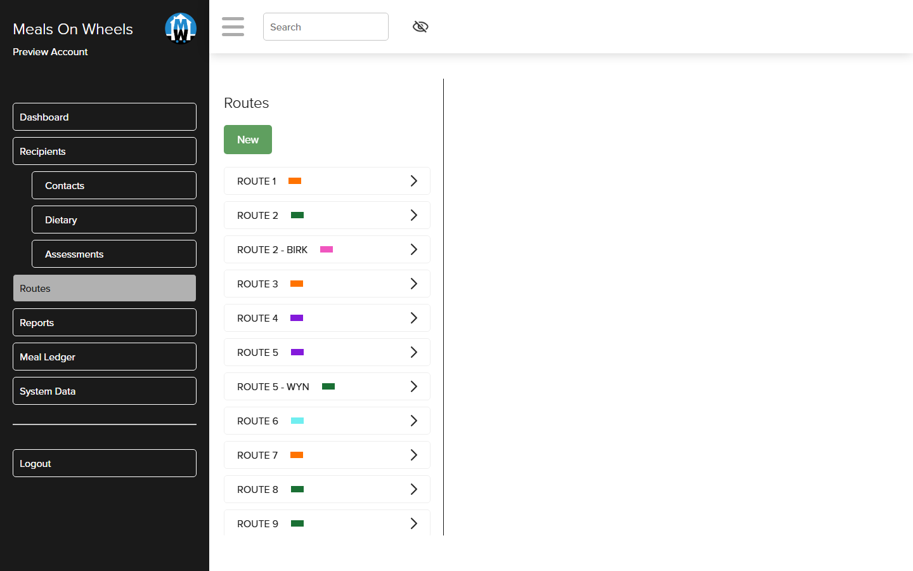
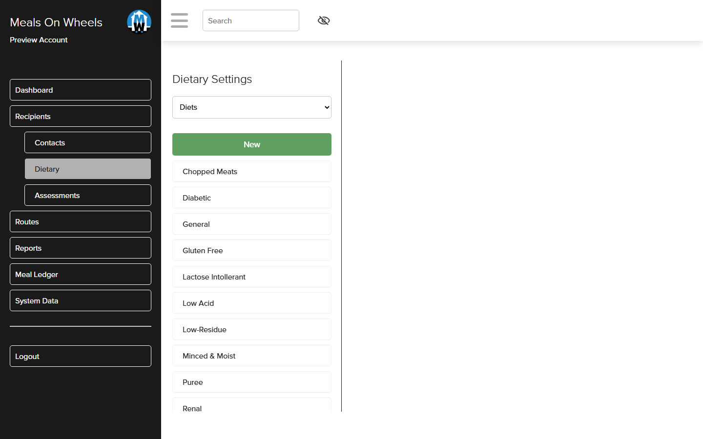
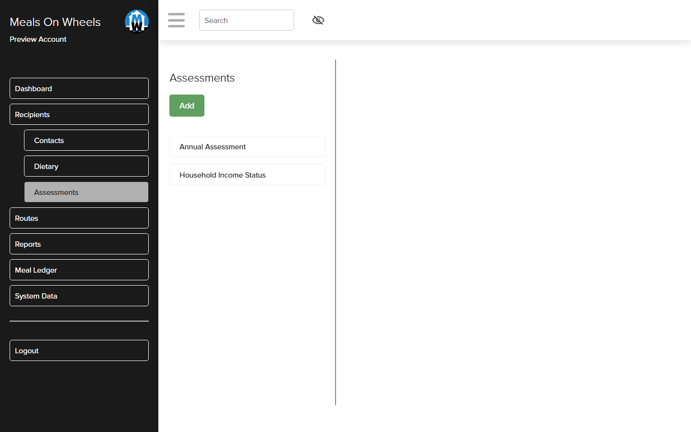

# Recipient and route management system for a Meals on Wheels program

An internal web application that runs a Meals on Wheels operation: the people who receive meals,
their routes and delivery positions, dietary needs and allergies, assessments, emergency contacts,
physician certifications, billing and insurance, and the printed labels and reports the kitchen and
office work from. It is a PHP and Microsoft SQL Server application, hosted on IIS, and holds the
program's live data (187 recipients, 16 routes, 44 tables).

I did not write the original system. I took it over for the client when its reports had stopped
working and nobody had the source under control: I got it running on a fresh machine from a
database backup, audited the whole codebase with evidence from a live instance, found and fixed the
real cause of the "reports do not generate" complaint, built the ten operational reports that had
been listed in the menu for years but never implemented, and handed it back under version control
with a setup guide a non-specialist can follow.



## What it does

**For office staff**
- A dashboard of what needs attention today: who is off today and tomorrow, temporary holds,
  follow-ups due, assessments due and physician certifications about to expire
- Recipient records with status history, contacts and relationships, diets, allergies,
  accommodations and milk choices, days off, billing type and insurance
- Routes with colour coding and ordered delivery positions, and scheduled route changes that apply
  themselves on the date they are due
- Assessments built from a question builder with scoring (annual assessment, household income)
- A meal ledger by month, program and route, with drill-down, which is the basis for billing
- System data screens for the lookup lists (relationships, genders, ethnic groups, and so on)

**For the kitchen and drivers**
- Hot-meal and frozen-meal labels generated as PDF for the day's routes, carrying each recipient's
  diet, allergies and accommodations

**For management and funders**
- Fourteen printable reports, each generated live from the database as a PDF: the four that existed
  (hot labels, frozen labels, individual recipient report, insurance billing) and the ten I added

## The ten reports I built

All ten follow the application's existing pattern (a parameter form under `menu/reports/forms/`,
a report body under `viewReport/includes/reports/`, Dompdf for the PDF), so the next developer
finds one way of doing things rather than two.

| Report | Parameters | What it answers |
|---|---|---|
| Follow Ups Needed | due on or before | Which recipients have a follow-up outstanding |
| Physician Certification Due | days ahead | Whose certification lapses soon, with physician and clinic |
| Assessment Due | due on or before | Who is due a reassessment |
| Status Change Report | date range, status | Who moved to a status in a period |
| Closed Call List | none | Recipients no longer active, with when and why |
| Under 60 | as-of date | Recipients under sixty, needed for funding rules |
| Route Totals | none | Head count per route |
| No Donation | date range | Recipients with no donation in a period |
| Unduplicated Program Count | date range | Distinct people served per program, from the meal ledger |
| Interventions | date range | Logged interventions by recipient |

Two of them, Follow Ups Needed and Interventions, show an empty-state message until staff record
such data, because the database had none yet. "Closed" is interpreted as the system's Non Active
status, and the handoff notes say so, since the application has no literal Closed status.

## What the audit found

The audit was run against a live instance, with every finding tied to a file and line or a query
result. The main conclusions:

- **The PDF engine was never broken.** All four existing reports produced valid PDFs when called
  directly. The report screen failed because jQuery was loaded from a public CDN that the client's
  locked-down browsers could not reach, so the report list never rendered and Generate did
  nothing. jQuery and jQuery UI are now served from the application itself.
- **Fourteen of eighteen menu entries had no implementation** and fell through to a
  "No Report Found" default. Ten are now built; Assessment Detail Report, Statements, Statement
  Listing and OAA Reporting remain unimplemented and are listed as such in the handoff.
- **Real risks in the code as received:** database credentials hard-coded in the connection class,
  a one-time data migration that re-ran on every page load for the first user, a recipient
  assessment handler killed by a stray `exit()`, report stylesheets fetched from the production
  website over the internet, no CSRF protection on write handlers, no foreign keys and no tests.
  Each is documented with severity and location in `DUE_DILIGENCE_AUDIT.md` and
  `PROJECT_STATUS.md`, with a rule of thumb for estimating future changes.
- A JavaScript error on load (a missing `appendForms()` function) halted the page's scripts and was
  fixed.

## How it is built

- **Single-page shell.** `index.php` renders the frame; every menu loads through jQuery AJAX from
  `menu/menuContent.php`, which includes one module from `menu/menus/`
- **Data access.** `classes/db.class.php` is a thin PDO wrapper over the `sqlsrv` driver; queries
  are parameterised throughout
- **Sign-in.** Session based, bcrypt password hashes, `isAdmin` and permission levels checked in
  `classes/security.php`
- **CRUD pattern.** `addContentForms/` and `editContentForms/` for the UI, `handlers/` for writes,
  `getData/` for reads
- **Reports.** `viewReport/index.php` builds HTML for the requested report and streams it through
  Dompdf; PhpWord is vendored but only used by a label prototype
- **Local development.** `router.php` emulates IIS clean URLs under PHP's built-in server, and the
  connection is pointed at a local SQL Server Express instance with the production values kept in
  comments for deployment

## Stack

| Layer | Choice |
|---|---|
| Application | PHP 8.3, procedural with two small classes |
| Database | Microsoft SQL Server (attached `.mdf`/`.ldf`), `pdo_sqlsrv` |
| Front end | jQuery 3.6, jQuery UI, CKEditor 5, hand-written CSS |
| PDF and Word | Dompdf (vendored), PhpWord (vendored, prototype only) |
| Hosting | IIS (`web.config`) in production; PHP built-in server with `router.php` locally |

## Screenshots

| | |
|---|---|
|  |  |
| The dashboard (recipient entries blurred) | Sign in |
|  |  |
| Routes with their colour codes | Dietary settings: diets, allergies, accommodations |
|  | |
| Assessment templates | |

The screenshots show the application running locally on PHP 8.3 against the shipped database
attached to SQL Server Express. The database contains real program data, so pages that list
recipients are not shown and the recipient entries on the dashboard are blurred.

## Running it locally

```
winget install --id PHP.PHP.8.3 --scope user              # PHP 8.3 x64 thread-safe
winget install --id Microsoft.msodbcsql.18                # ODBC Driver 18
winget install --id Microsoft.SQLServer.2022.Express      # then add php_sqlsrv / php_pdo_sqlsrv to ext/
sqlcmd -S localhost\SQLEXPRESS -E -C -Q "CREATE DATABASE [MealsOnWheels] ON (FILENAME='C:\...\MealsOnWheels.mdf'),(FILENAME='C:\...\MealsOnWheels_log.ldf') FOR ATTACH;"
cd mow
php MealsonWheels\tools\create-test-user.php              # CLI only; creates a known test login
php -S localhost:8090 -t MealsonWheels MealsonWheels\router.php
```

`mow/SETUP.md` has the full walkthrough. There is no `.env`; the database connection is
configured in `classes/db.class.php`, which is pointed at the local instance (one of the audit's
findings is that credentials belong in configuration, not in the class).

## Repository notes

- `mow/` is the canonical copy. `mow/.git-history/` is the original nested git metadata preserved
  as plain files; it records six commits, from the baseline as received, through the reports
  build-out and fixes, to the handoff guide and test-user tool.
- `MealsOnWheels-Handoff/` is the identical copy packaged for the client; `mow.zip` and
  `MealsOnWheels-handoff.zip` are archives of the same two folders. The empty nested `mow/mow/` and
  `MealsOnWheels-Handoff/MealsOnWheels-Handoff/` folders are leftovers from unzipping.
- `MealsOnWheels.mdf` and `MealsOnWheels_log.ldf` (10 MB together) are the program's database as
  shipped and contain real recipient data; treat them accordingly.
